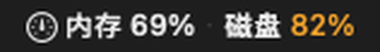

# 系统监视（macOS 菜单栏）

一个不依赖 DSH、不依赖第三方运行时的本机菜单栏小程序。常驻菜单栏显示内存和磁盘占用，点开可以看明细，并找出当前最占内存的应用。



## 功能

- 菜单栏实时显示 `内存 69% · 磁盘 82%`，默认每 5 秒刷新（可调 2/5/10/30 秒）
- 点击展开：
  - **内存占用应用**：前 10 个 Dock 应用，按物理内存（physical footprint）排序；Chrome / Safari / Electron 的渲染进程、GPU 进程等 helper 会合并回主应用
  - **其余应用**：第 11 个之后的应用放在「其余 N 个应用」二级菜单里，每一项同样可以点击退出
  - **内存**：已用 / 总量、可用、缓存、联动内存、交换空间
  - **磁盘**：每个挂载卷的已用 / 总量、可用、挂载路径
- **点击某个应用即可释放内存**：
  - 弹出确认框，默认按钮是「取消」
  - 「退出应用」= 正常退出（应用可能会弹保存提示）
  - 「强制退出」= 立即终止，未保存内容一定丢失
  - 对 DeepSeek Harness 会额外警告「这会关闭当前 DSH 会话」
- 用量条按阈值变色：≥75% 橙色，≥90% 红色
- 纯 AppKit + Mach/statfs + libproc，无网络、无权限申请、无后台常驻进程
- 开机自动启动：通过用户级 LaunchAgent 实现，不需要管理员密码；菜单里的「开机启动」可以随时开关
- 单实例运行，重复打开不会叠出第二个图标

> macOS 没有“不退出进程、只强制回收某个 App 内存”的公共 API，所以这里的“释放”就是退出该应用；这是真正能立即把内存还给系统的做法。

## 构建

需要 macOS 13+ 和 Xcode Command Line Tools（`xcode-select --install`）。

```sh
cd ~/Desktop/SystemMonitor
./build.sh
open SystemMonitor.app
```

首次启动后，菜单栏右侧会出现仪表盘图标和占用百分比。App 使用 `LSUIElement`，不会出现在 Dock 里。

## 安装到用户「应用程序」

```sh
mkdir -p ~/Applications
ditto SystemMonitor.app ~/Applications/SystemMonitor.app
open ~/Applications/SystemMonitor.app
```

菜单里的 **开机启动** 开关会写入 `~/Library/LaunchAgents/local.systemmonitor.plist`，登录时自动拉起；本机已启用。移动过 App 之后关一次再开一次即可把路径更新到新位置。

## 使用

1. 点菜单栏的 `内存 xx% · 磁盘 xx%`。
2. 在「内存占用应用」里找到占内存最多的应用；第 11 个之后的在「其余 N 个应用」二级菜单。
3. 点击该应用 → 选择「退出应用」或「强制退出」。
4. 应用退出后，下一次刷新就会从列表消失，内存占用随之下降。

其他菜单项：

- **刷新**：立即重读一次
- **刷新间隔**：2 / 5 / 10 / 30 秒
- **开机启动**：勾选 / 取消开机自动运行
- **打开活动监视器**：跳转到系统自带的详细视图
- **退出系统监视**

## 命令行读取一次

```sh
SystemMonitor.app/Contents/MacOS/SystemMonitor --once
```

输出 JSON，包含内存、磁盘和当前应用内存排行，便于接入脚本或做快速核对：

```json
{
  "memory": { "total": 17179869184, "used": 11783020544, "available": 5396848640 },
  "disks": [{ "name": "Macintosh HD", "path": "/", "total": 494384795648, "used": 407052521472, "percent": 82 }],
  "apps": [{ "name": "Google Chrome", "pid": 73790, "footprint": 430992880 }]
}
```

## 指标口径

- **内存已用** = 物理内存 − 可回收内存（free + inactive + speculative + purgeable），与活动监视器的「已用内存」接近，但不是逐项复刻。
- **交换空间**来自 `sysctlbyname("vm.swapusage")`。
- **应用内存**来自 `proc_pid_rusage` 的 `ri_phys_footprint`（活动监视器 Memory 列同源）；按可执行文件所在的 `.app` bundle 归属，因此 Chrome Renderer、Safari WebContent、Electron Helper 会合并到主应用；没有 bundle 归属的子进程再按进程树归并。
- **列表范围**只包含 Dock 中运行的常规 App（`activationPolicy == .regular`），不包含纯菜单栏工具、系统守护进程和内核；被 launchd 接管的系统 XPC 服务可能不计入某个 App。
- **磁盘**用 `statfs` 读取；APFS 下根卷和数据卷共享容器空间，因此只显示一个合并后的容量，外接卷单独列出。
- **磁盘可用**取 `f_bavail`（普通用户可写空间），会略小于 `f_bfree`。

## 开发

```sh
# 构建并启动
./build.sh
open SystemMonitor.app

# 只读一次指标
./SystemMonitor.app/Contents/MacOS/SystemMonitor --once

# 开发辅助：1.2 秒后自动展开菜单，2 秒后把状态栏和明细行渲染到目录
open SystemMonitor.app --args --preview-menu --capture /tmp/sm-capture
```

修改 `Sources/main.swift` 后重新 `./build.sh`，退出旧实例（菜单 → 退出系统监视），再打开即可。代码约 1100 行，全部在单文件里。

登录项也可以从命令行开关（路径必须与当前 App 一致）：

```sh
SystemMonitor.app/Contents/MacOS/SystemMonitor --enable-login
SystemMonitor.app/Contents/MacOS/SystemMonitor --disable-login
```

## 卸载

先在菜单里取消「开机启动」（或执行 `--disable-login`），再退出菜单栏 App，最后把 `SystemMonitor.app` 移到废纸篓。这样不会留下登录项。

如果忘记取消，也可以手动清理：

```sh
launchctl bootout gui/$(id -u)/local.systemmonitor 2>/dev/null
rm -f ~/Library/LaunchAgents/local.systemmonitor.plist
```
